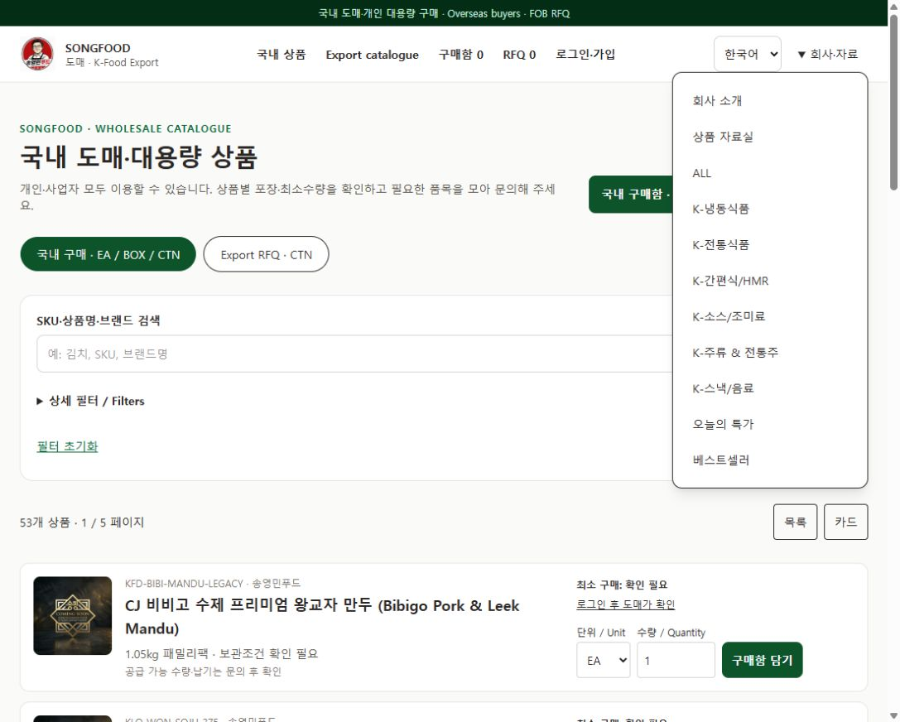
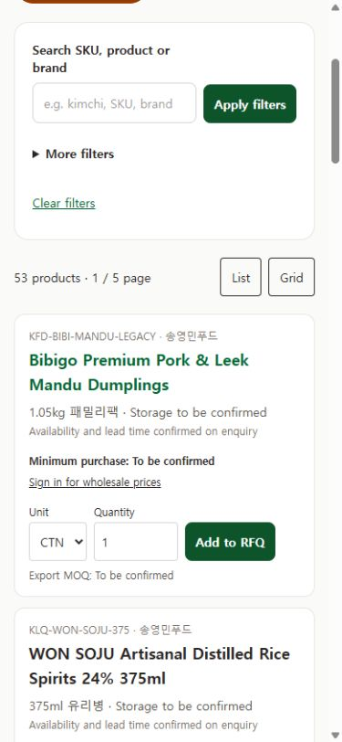

# 송영민푸드 고객 상품 탐색 UI UX 점검 및 수정계획

검토일: 2026-10-15 KST · 기준 소스: 325a6e5 · 실제 개발 폴더: C:/Users/Microsoft/Projects/songfood

## 1. 결론과 이번 범위

고객의 상품 검색과 카테고리 탐색에는 실제 동작 오류가 있다. 기존 ‘K-냉동식품’ 메뉴가 전체 상품으로 연결되고, 검색 결과에서 상품 상세를 확인한 뒤 화면의 카탈로그 링크로 돌아가면 검색 조건이 사라진다. ‘bibigo mandu’ 검색도 해당 상품이 있는데 결과가 없다.

우선 이 동작 오류를 수정하고, 기존 분류를 활용해 카테고리 진입·상품 식별·상세에서의 연속 탐색을 개선한다. 국내 도매고객·개인 대용량 구매자·해외 바이어가 같은 상품 구조를 이용하되 거래 유형과 언어는 각각 유지한다.

**2026-10-15 추가 개발 승인으로 UX-01~UX-04 기능 구현과 로컬 통합 검증을 완료했다.** 구현 내용·검증 범위·운영자 사용법은 [구현 기록](B2B_CUSTOMER_NAVIGATION_UX_IMPLEMENTATION_2026-10-15.md)을 따른다. 아래 2~4절은 구현 전 관찰과 승인된 수정 기준이며, 과거 재현값을 현재 결과로 오해하지 않도록 구분한다. 운영 상품·가격·직원·출시 정책·주문·RFQ·PI·인수 자료를 변경하지 않았고 15단계 실제 거래 인수 보류는 별도 조건이다.

## 2. 고객 화면에서 확인한 문제

운영 URL은 https://song-food.jwmaxum.workers.dev 이다. 비로그인 고객의 실제 화면을 데스크톱 1102×884와 모바일 390×844에서 점검했다. 한글·영문, 국내·해외 카탈로그, 검색·카테고리 선택, 상품 상세·목록 복귀 및 홈을 확인했다. 실제 고객 거래는 제출하지 않았다.

### 2.1 우선순위와 재현 근거

P1은 상품 찾기와 탐색 맥락을 직접 훼손하는 항목, P2는 발견성과 비교 편의 개선이다.

| ID | 우선 | 고객이 겪는 상황과 확인 근거 | 수정 방향 |
| --- | --- | --- | --- |
| F01 | P1 | ‘회사·자료 → K-냉동식품’을 누르면 /collections?cat=fresh&lang=ko로 이동하지만 카테고리 값은 비어 있고 전체 53개가 표시됨. 소주·막걸리도 같은 결과에 포함 | 기존 cat URL을 현재 분류/보관 필터로 해석. 의미가 모호한 옛 링크는 분류 선택 안내. 새 메뉴는 정식 검색 URL 사용 |
| F02 | P1 | ‘만두’ + ‘만두 & 교자’ 검색은 7개. 상품 상세의 ‘상품 카탈로그’ 링크는 /shop?lang=ko여서 검색어·카테고리를 잃음. 해외 상세의 링크도 /shop?lang=en으로 mode=export가 빠짐 | 검색 결과로 돌아가기와 상위 카테고리 이동을 구분하고 q·필터·page·view·sort·mode·lang 복원 |
| F03 | P1 | 영문 해외 목록에서 bibigo mandu는 0개, mandu는 7개. 코드가 검색 문장 전체를 각 필드에 포함하는지만 검사 | 공백·대소문자·유니코드 정규화, 단어별 AND 검색과 SKU 정확 일치 우선 |
| F04 | P1 | 영문 목록의 21개 카테고리는 한글. 영문 상세의 ‘Related products’ 상품명도 한글. 목록 상품명은 language 대신 exportMode로 한영을 결정 | 한영 분류 표시명과 공통 상품 표시 함수 사용. 언어 선택과 거래 유형 분리 |
| F05 | P2 | 기본 카테고리는 닫힌 ‘상세 필터’ 안에 있음. 별도 카테고리 메뉴는 ‘회사·자료’에 섞임. 홈에는 상품 검색창과 분류별 진입 영역이 없음 | 상품 찾기를 위한 전용 카테고리 메뉴·홈 진입·검색창 제공 |
| F06 | P2 | 모바일 기본 목록에서 상품 이미지가 모두 숨겨짐. 기본 영문 해외 목록의 첫 상품 상단은 화면 위에서 약 711px. 가로 넘침은 없었음 | 작은 썸네일을 유지하는 목록, 간결한 검색/선택 조건, 첫 상품 노출 위치 개선 |
| F07 | P2 | 사용자 정렬 선택 없이 서버의 ID 순서. 페이지 이동은 이전/다음과 현재 번호뿐. 적용 필터를 개별 해제하는 칩이 없음 | 상품명·SKU·관리자 추천 순의 명시적 정렬, 선택 조건 칩, 페이지 접근 보완 |
| F08 | P2 | 상세의 현재 위치는 홈/상품 카탈로그/SKU. 대분류·제품종류 링크와 같은 결과의 이전/다음이 없음. 관련 상품은 같은 collection의 앞 3개 | 분류 경로, 같은 분류 더 보기, 결과 내 이전/다음, 언어·맥락을 유지하는 관련 상품 |
| F09 | P2 | 브랜드에 ‘송영민푸드’ 8개와 ‘송영민푸드 (Songfood)’ 42개가 따로 표시됨. 비비고 왕교자에 LEGACY와 별도 SKU가 함께 노출됨 | 브랜드 표시·검색 별칭 정리, 중복 후보 관리자 대조. 공급사·실상품 동일 여부 확인 전 자동 병합/삭제 금지 |
| F10 | P2 | 상단 현재 메뉴는 pathname만 비교하므로 해외 목록에서도 /shop의 국내 메뉴가 현재 페이지로 표시될 수 있음 | 경로와 mode를 함께 사용해 현재 메뉴·거래 유형 표시 일치 |
| F11 | P1 | 해외 목록 검색 0건의 ‘Ask about a product’ 링크가 국내 문의 /wholesale?lang=en으로 연결됨 | 국내는 국내 문의, 해외는 /rfq?lang=en의 맥락에 맞는 안내. 0건 화면에서 필터 완화/초기화 지원 |

F10의 aria-current 조건과 F08의 관련 상품 선정 방식은 소스 확인 항목이다. 그 외 주요 재현값은 실제 운영 화면 또는 공개 상품 API에서 확인했다. 검색 순위·전환율 개선 효과는 실제 고객 측정 후 판단한다.

### 2.2 현재 유지할 동작

- 목록의 검색어·필터·거래 유형·페이지·보기 방식은 URL에 반영된다. 이 구조를 확장한다.
- 상품명·SKU·브랜드·영문명 검색, 보관 조건·최소구매 필터, 목록/카드 전환은 존재한다.
- 모바일 390px의 점검 화면에서 가로 넘침은 없었다. 큰 화면과 작은 화면의 핵심 탐색 기능을 함께 유지한다.
- 개인 회원의 회사·사업자번호 선택 입력, 승인 없는 이메일 가입, 국내 구매함/해외 RFQ 분리와 서버의 가격·MOQ 검증을 유지한다.
- 미확정 가격·포장·MOQ를 임의 값으로 채우거나 카테고리 노출을 판매 승인으로 취급하지 않는다.

### 2.3 화면 증거

기존 카테고리는 ‘회사·자료’ 아래 있으며, K-냉동식품 링크 이동 후에도 전체 53개 결과가 표시된다.

모바일 영문 목록은 썸네일 없이 긴 상품명과 주문 입력을 먼저 표시한다. 아래 캡처는 목록까지 스크롤한 상태다. 첫 상품의 711px 위치는 초기 화면 DOM 측정값이다.

## 3. 고객에게 보여줄 상품 분류와 화면 구성

### 3.1 기존 9개 대분류와 21개 제품종류 재사용

2026-10-15 공개 상품 API는 상품 53개를 반환했다. 현행 data/product-taxonomy.json과 일치하는 대분류를 사용한다. DB의 collection/category 값을 바로 바꾸지 않고 고객 표시명·영문명·URL 해석을 별도 매핑한다.

| 고객 대분류 표시안 | 영문 표시안 | 기존 collection | 현재 상품 수 | 제품종류 |
| --- | --- | --- | ---: | --- |
| 김치·발효식품 | Kimchi & Fermented Foods | K-김치/발효식품 | 7 | 김치 & 발효식품 |
| 만두·냉동식품 | Dumplings & Frozen Foods | K-만두/냉동식품 | 7 | 만두 & 교자 |
| 간편식·국·밀키트 | Ready Meals & Meal Kits | K-간편식/HMR | 8 | 떡볶이 & 밀키트, 국 & 탕류, 간편식 & 조리육류 |
| 면류·라면 | Noodles & Ramyeon | K-면류/라면 | 6 | 라면, 생면 & 국수, 당면 |
| 소스·장류·조미료 | Sauces & Seasonings | K-소스/장류 | 7 | 장류, 소스 & 양념, 분말 조미료 |
| 김·수산가공·건어물 | Seaweed & Seafood | K-김/수산가공 | 6 | 김 가공품, 해조류, 어묵 & 수산가공, 건어물 & 안주류 |
| 스낵·전통과자 | Snacks & Traditional Sweets | K-스낵/전통과자 | 6 | 스낵 & 과자, 전통과자 |
| 주류·전통주 | Korean Alcoholic Beverages | K-주류/전통주 | 4 | 증류식 소주, 막걸리 & 탁주 |
| 음료·전통차 | Drinks & Traditional Teas | K-음료/전통차 | 2 | 전통 음료, 전통차 |

분류는 상품 종류, 냉동/냉장/상온은 별도 보관 필터다. ‘냉동’ 선택을 만두 상품만으로 제한하지 않는다. 등록 보관 정보가 없는 상품을 상품명만 보고 냉동으로 확정하지 않는다. 상품 수는 현재 공개 카탈로그·선택 필터의 범위에서 계산하며 관리자 전용 재고·계약가격·미공개 메타데이터를 사용하지 않는다.

### 3.2 고객 화면 배치안

| 화면 | 데스크톱 | 모바일 |
| --- | --- | --- |
| 공통 헤더 | 로고, 상품 검색, 카테고리, 국내/해외, 구매함/RFQ/계정. 회사·자료는 별도 보조 메뉴 | 로고·언어·메뉴 아래 검색. 카테고리를 메뉴 깊숙이 숨기지 않고 바로 열 수 있는 버튼 |
| 홈 | 국내/해외 선택과 9개 분류 진입을 검색 근처에 배치. 이미지 중심 대표 상품은 그 다음 | 긴 소개 영역을 줄이고 검색 → 카테고리 → 상품 순으로 접근 |
| 상품 목록 | 좌측 2단계 분류, 우측 검색어·선택 조건·결과 수·정렬·상품. 상단에 현재 대분류 명시 | 대분류 빠른 선택 + ‘카테고리 전체’ 패널. 브랜드·보관·MOQ는 별도 필터 패널 |
| 상품 목록 항목 | 이미지·상품명·SKU·내용량·보관·확인된 MOQ/가격 상태를 일정한 위치에 배치 | 작은 이미지가 있는 한 줄형 요약. 단위·수량·담기는 펼치거나 간결하게 배치 |
| 상품 상세 | 검색 결과 복귀, 분류 경로, 상품 정보, 국내/해외 행동 영역, 같은 분류/관련 상품 | 복귀와 분류 경로를 상단에 유지. 결과 내 이전/다음과 주요 행동에 쉽게 접근 |

카테고리는 목적지 링크로, 필터 패널 열기·닫기는 버튼으로 구현한다. 21개 항목 전체를 한 줄 탭으로 늘어놓지 않는다. 로그인 없이 분류·검색·상품 확인은 가능하고, 가격·실제 구매 권한은 기존 정책을 따른다.

목록 정렬의 기본은 명확한 안정 순서로 시작한다. 상품명·SKU·관리자 추천 순을 제공하고 동률은 ID로 고정한다. 검증된 판매 데이터가 없는데 ‘인기순’이나 ‘베스트셀러’라고 표시하지 않는다. 가격순은 승인 가격의 적용 범위·단위 비교 기준을 별도로 합의한 뒤 추가한다.

## 4. 수정 기능의 동작 기준

### 4.1 URL과 기존 링크 호환

정식 목록 진입점은 /shop을 사용한다. collection·category·q·brand·storage·market·minimum·maxMinimum·mode·lang·page·view·sort를 명시적으로 처리하고 허용된 키만 복귀 맥락으로 전달한다.

- 대분류를 선택하면 해당 collection만, 제품종류를 선택하면 그 collection과 category를 함께 적용한다.
- 대분류가 바뀌면 호환되지 않는 category를 해제하고 page=1로 이동한다. 국내/해외 전환은 공통 검색·분류·언어를 보존하고 해당 화면에 의미 없는 조건은 명확히 해제한다.
- 검색과 필터 변경은 첫 페이지로 이동한다. 상세 확인 후 복귀는 기존 page와 view·sort를 유지한다.
- /collections의 기존 링크는 정식 동작과 연결한다. 명시적 category/collection과 옛 cat 값이 충돌하면 명시적 정식 조건을 우선하고 옛 조건은 제거한다.
- 모르는 cat이나 삭제된 분류를 전체 상품 선택처럼 조용히 처리하지 않는다. ‘이 분류가 변경되었습니다’와 현재 분류 선택/전체 상품 링크를 제공한다.
- 특가·베스트셀러는 실제 운영 근거와 일치하는 조건이 있을 때만 표시한다. 단순히 전체 상품 URL에 해당 이름을 붙이지 않는다.

기존 별칭은 화면 제목을 기준으로 검토한다. fresh는 코드 이름이 아니라 기존 ‘냉동식품’ 의미에 따라 storage=frozen을 후보로 한다. pantry는 간편식/HMR, sauce는 소스/장류, dairy는 기존 표시명인 주류/전통주에 맞춰 대조한다. traditional·snack처럼 현재 여러 분류에 걸치는 이름과 deals는 관리자 미리보기에서 매핑을 검토하고, 모호하면 현재 분류 선택 안내로 보낸다. DB 상품 분류를 별칭에 맞춰 일괄 변경하지 않는다.

### 4.2 검색과 결과 없음

첫 구현은 현재 공개 상품 규모에 맞춰 기존 검색 함수를 개선한다. 외부 검색 SaaS나 새 유료 서비스는 필요하지 않다.

1. 검색어와 검색 필드를 Unicode NFC·소문자·공백 정규화한다. 일반 문자는 일반 문자열로 처리하고 사용자 검색어를 실행 가능한 정규식으로 만들지 않는다.
2. 여러 단어를 나누어 SKU·한영 상품명·브랜드·분류의 검색용 문서에서 모든 단어가 맞는지 검사한다. 단어 순서가 달라도 찾도록 한다.
3. SKU 완전 일치 → 상품명 문구 일치 → 모든 단어 일치 순으로 관련도를 주고 동률은 안정 순서로 정렬한다.
4. SKU 하이픈·공백 표기 차이는 SKU 비교용 정규화로 보완한다. 김치/kimchi, 만두/mandu/dumpling 등 관리 가능한 식품 별칭은 명시적 사전으로 추가하며 판매자·원산지 정보로 오해될 자동 번역은 피한다.
5. 결과 0건에는 검색어 수정, 개별 조건 해제, 전체 초기화, 현재 대분류 보기와 해당 거래 유형의 문의를 제공한다. 전체 목록을 성공한 검색 결과처럼 자동 대체하지 않는다.

자동완성은 후속 선택 기능이다. 우선 Enter·검색 버튼, 결과 수, 선택 조건과 복귀를 안정화한다. 도입 시 상품명·SKU·분류를 구별하고 키보드·Escape·포커스 처리를 검증한다.

### 4.3 목록과 상세에서 탐색 계속하기

- ‘검색 결과로 돌아가기’는 검색 결과 맥락, ‘만두 & 교자 전체 보기’는 해당 분류 목록으로 연결한다. 두 기능을 같은 /shop 링크로 만들지 않는다.
- 분류 경로는 홈 → 상품 → 대분류 → 제품종류 → 현재 상품으로 구성하고 마지막 항목은 읽을 수 있는 현재 상품명을 사용한다. SKU는 별도 정보로 유지한다. 명명된 nav 영역과 현재 위치 표시는 [WAI Breadcrumb Pattern](https://www.w3.org/WAI/ARIA/apg/patterns/breadcrumb/)을 따른다.
- 결과 내 이전/다음은 현재 필터·정렬의 상품 집합에서 결정한다. 최초/마지막에서는 해당 방향을 비활성화하고 순환하지 않는다. 필터 결과가 바뀌면 최신 결과를 기준으로 안내한다.
- 직접 URL로 방문해 이전 검색이 없으면 현재 대분류/제품종류 목록을 복귀 기본값으로 사용한다. 브라우저 방문기록이 있다는 가정으로 history.back만 실행하지 않는다.
- 복귀 경로는 /shop 또는 /collections 내부 경로와 허용된 매개변수만 받아 길이를 제한한다. 외부 URL·//·백슬래시·임의 next 값으로 이동하지 않는다.
- 같은 탭의 복귀 위치는 결과 URL과 상품 ID 기준으로 복원하고 다른 검색의 스크롤을 가져오지 않는다. 새 탭에는 명시적 URL 맥락을 전달하고 전역의 마지막 검색 하나에 의존하지 않는다.
- 관련 상품은 같은 제품종류 우선, 그 다음 같은 대분류를 사용한다. 현재 상품 제외, 중복 ID 제거, 안정 순서, 현재 공개 범위를 적용한다. 썸네일·언어에 맞는 상품명·규격·MOQ 상태를 제공한다.
- 국내/해외 선택이 상세와 관련 상품·복귀에도 유지되도록 한다. 가격·상품 공개 조건의 현재 서버 검증을 우회하지 않는다.

### 4.4 언어·모바일·관리자 일관성

한영 표시를 공통 함수로 처리해 홈·목록·상세·관련 상품·분류 메뉴에서 동일하게 사용한다. 국내 모드여도 English를 선택하면 영문 상품명을 표시한다. 브랜드는 고유명사를 보존하면서 선택 목록용 표시와 검색 별칭을 분리한다.

상품 관리자에 이미 있는 collection/category 선택을 고객 분류의 원본으로 사용한다. 현재 단계에서는 새로운 카테고리 CRUD나 DB 구조를 먼저 만들지 않는다. 메뉴 관리에는 임의 URL 예시 대신 ‘상품 분류 선택 → 목적지 미리보기 → 한영 확인’ 동선을 제공하는 방향으로 개선한다. 하위 관리자의 기존 업무 권한을 넓히지 않는다.

모바일은 작은 썸네일을 항상 유지하고 검색·카테고리를 첫 화면에서 찾을 수 있게 한다. 390×844 기본 목록에서 첫 상품 상단 560px 이내를 내부 목표로 잡고 긴 상품명·선택 필터·글자 확대에서도 상품 정보와 버튼이 겹치지 않는지 확인한다. 화면 높이가 다른 기기까지 동일한 좌표를 보장하는 규칙으로 사용하지 않는다.

주요 카테고리·검색·필터 버튼은 높이 44px 이상을 내부 설계 목표로 한다. WCAG 2.2 AA의 최소 타깃은 24×24 CSS px 또는 정해진 예외/간격 조건이며, 44px를 AA의 일률적 의무값으로 설명하지 않는다. [W3C 타깃 크기 설명](https://www.w3.org/WAI/WCAG22/Understanding/target-size-minimum.html)

패널 닫기·Escape 후 열기 버튼으로 포커스를 돌리고, 결과 수는 상태 메시지로 알린다. 검색 결과 갱신만으로 매번 키보드 포커스를 빼앗지 않는다. [W3C 상태 메시지 설명](https://www.w3.org/WAI/WCAG22/Understanding/status-messages.html)

## 5. 실행할 개발 순서

기간은 개발자 1명 기준 예상 6~9 작업일이며 운영자의 분류/브랜드 자료 확인과 실제 고객 검수 대기는 별도다. 각 묶음을 별도 요청·검증·배포할 수 있다.

| 요청 ID | 수정 범위 | 선행조건 | 예상 | 완료 기준 |
| --- | --- | --- | --- | --- |
| UX-01 | 기존 카테고리 링크·검색 URL 정리, 여러 단어 검색, 상세→결과 복귀, mode/lang 및 0건 문의 보존 | 현재 분류·공개 상품 기준 | 1~2일 | F01/F02/F03/F11 재현 오류 해소. 모호한 옛 분류는 안내. 검색·복귀 회귀 통과 |
| UX-02 | 9개 대분류/21개 제품종류 전용 탐색, 한영 분류, 홈·헤더 검색, 적용 조건 칩·정렬 | UX-01의 URL 계약 | 2~3일 | 카테고리가 상세 필터/회사 메뉴에 의존하지 않음. 모든 진입점 결과·언어 일치 |
| UX-03 | 상세 분류 경로·같은 분류 보기·이전/다음·관련 상품 이미지·한영 표시 통일 | UX-01 맥락, UX-02 분류 표시 | 2일 | 상세·관련 상품·새 탭·직접 방문·목록 복귀의 맥락과 위치 검증 |
| UX-04 | 모바일 정보 밀도·터치·키보드·접근성 마감, 메뉴 미리보기·브랜드/중복 후보 점검 가이드, 통합 회귀 | UX-01~03 | 1~2일 | 360/390/768/1024/1440px 및 한영·양채널의 검수 기준 통과 |

당초 요청은 계획 정리였으며, 이후 사용자의 상세 수정계획 개발 요청에 따라 위 UX-01~04 전체를 구현했다. 시작할 때 설치된 node_modules/next/dist/docs의 해당 버전 지침과 현재 변경을 다시 읽는다. 기존 B2B 기능을 재사용하고 새 라이브러리가 필요한 경우에만 search-first 절차로 대안을 검토한다.

### 5.1 예상 변경 파일

| 영역 | 기존 코드 근거 | 구현 시 변경 방향 |
| --- | --- | --- |
| URL·검색·페이지 | src/lib/storefront.ts:24, :28, :46 | collection/옛 별칭/정렬/다중 단어와 맥락 처리. 검색·조회 함수의 계약 통일 |
| 카탈로그 | src/app/collections/CollectionShowcaseClient.tsx:44 | 분류·필터·상태·모바일 카드·정렬·상세 링크 |
| 목록 진입점 | src/app/shop/page.tsx, src/app/collections/page.tsx | 정식/기존 URL의 일관된 처리 |
| 분류 원본 | data/product-taxonomy.json, src/lib/product-taxonomy.ts | 기존 원본 유지, 고객 표시·영문·URL 매핑 재사용 |
| 헤더·홈·기존 메뉴 | src/components/layout/HeaderClient.tsx:25, CmsLinks.tsx:6, src/app/page.tsx:13 | 검색·카테고리 진입·현재 메뉴·옛 CMS 링크 보정 |
| 상세·관련 상품 | src/app/products/[id]/ProductDetailClient.tsx:19, :33 및 page.tsx:13 | 결과 복귀·분류 경로·이전/다음·선정·표시 통일 |
| 언어 | src/lib/i18n, src/components/layout/LocalizedLink.tsx | 실제 표시명과 URL 보존. UI 언어/거래 유형 분리 |
| 관리자 메뉴 | src/app/admin/navigation/NavigationManager.tsx:515 | 잘못된 옛 URL 예시 제거, 정식 분류 선택·미리보기 |
| 검증 | src/__tests__/b2b-storefront.test.ts, e2e/launch.spec.ts | 실제 재현 조건·다른 분류·옛 URL·복귀·언어를 포함한 격리 fixture 확장 |

카테고리 메뉴·검색 폼·상품 요약은 여러 화면에서 공통 컴포넌트로 재사용한다. 조회 API를 추가하기 전에 기존 공개 상품/가격 권한 경계를 재사용한다. 필요 없는 전면 개편·유료 검색 도입·운영 데이터 일괄 수정은 범위에 넣지 않는다.

## 6. 수정 후 인수 기준

아래는 승인된 인수 기준이다. 구현 후 자동 시험·실제 운영 탐색·별도 실거래 인수의 확인 범위는 [구현 기록](B2B_CUSTOMER_NAVIGATION_UX_IMPLEMENTATION_2026-10-15.md)에서 구분한다.

| ID | 시나리오 | 기대 결과 |
| --- | --- | --- |
| NAV-01 | 홈/헤더/목록에서 대분류와 제품종류 선택 | 같은 URL 계약과 같은 상품 집합. 기준 카탈로그에선 9개 분류 합계 53개, 만두 7개 |
| NAV-02 | fresh/pantry/sauce/dairy 등 옛 링크와 알 수 없는 cat | 검토된 현재 조건 또는 분류 변경 안내. 전체 53개를 해당 분류 결과처럼 표시하지 않음 |
| NAV-03 | 만두, mandu, bibigo mandu, 비비고 만두, SKU 완전 일치·하이픈 변형 | 실제 검색용 데이터에 맞는 일치 결과. 문장 중간 단어 때문에 정상 상품을 놓치지 않음 |
| NAV-04 | q·category·collection·view·sort·page와 해외/영문 설정 → 상세 → 결과 복귀 | 조건·결과 페이지·보기 방식·언어·거래 유형 및 해당 상품 위치 보존 |
| NAV-05 | 브라우저 뒤로/앞으로, 새 탭에서 상세 열기, 직접 URL 방문 | 전역 마지막 검색 오염 없음. 안전한 분류 기본 복귀. 외부 return URL 거절 |
| NAV-06 | 상세의 분류 경로·이전/다음·관련 상품 | 올바른 분류, 현재 상품명과 언어, 결과 첫/끝 경계, 현재 상품/중복 제외 |
| NAV-07 | English에서 국내 모드, Korean에서 해외 모드 | 상품명·분류·관련 상품의 언어는 언어 선택에 따르고 국내/해외 업무는 mode에 따름 |
| NAV-08 | 0건, 잘못된 필터 값, 분류 변경 후 page가 범위를 벗어남 | 해제·초기화·안내·해당 채널 문의 제공. 표시 페이지와 URL 상태 일치 |
| NAV-09 | 국내/해외 전환·필터 초기화·개별 조건 삭제 | 의미 있는 공통 조건 보존, 의존 조건 정리, 현재 메뉴·결과 수 일치 |
| NAV-10 | 360/390/768/1024/1440px, 키보드·Escape·200% 확대 | 가로 넘침·버튼 겹침 없음, 썸네일 유지, 초점 복귀, 결과 상태 안내 |
| NAV-11 | 로그아웃/개인/회사 계정과 승인·미승인/만료 가격·출시 제한 | 카테고리 개편으로 계약가격·내부 재고 유출이나 판매/발행 조건 우회 없음 |
| NAV-12 | 기존 구매함/RFQ·MOQ·가격/VAT/FOB·PI 표기·고객 업무 | 기존 동작 회귀 없음. 격리 fixture 검증 후 허가된 실제 고객 인수는 별도 |

자동 시험 fixture에는 같은 collection 안의 서로 다른 category, 두 개 이상의 결과 페이지, 한영 이름, 비슷한 SKU, 모호한 옛 메뉴, 결과 없음 사례가 필요하다. 현재 브라우저 fixture의 단일 QA 분류만으로는 잘못된 카테고리 링크를 충분히 잡기 어렵다.

코드 적용 때 타입·lint·관련 단위/권한 회귀·브라우저·Worker 빌드·diff/비밀값 검토 후 GitHub main push → Cloudflare 자동 배포를 확인한다. DB 구조가 바뀌는 경우에만 관련 SQL 회귀를 추가한다. 배포 후 비로그인 공개 경로와 사용자 허가 범위의 실제 탐색을 다시 확인한다.

## 7. 다음 개발 요청

UX-01~UX-04 기능 구현과 로컬 통합 검증을 완료했다. 별도 요청 없이 실행한 것으로 소급하지 않고, 사용자의 추가 개발 승인을 기준으로 기록한다.

다음 요청 예시:

> 관리자에서 실제 상품의 분류·한영 상품명·브랜드·규격과 중복 후보를 검수한 뒤, 15단계 실제 거래 인수를 재개해 주세요.

실제 가격·MOQ·회사/배송·반품·계좌·PI 판매자/환율·운영 담당자 등록과 허가된 실제 거래 인수는 별도 선행조건이며 이번 UI 구현만으로 상업 공개를 완료 처리하지 않는다.
